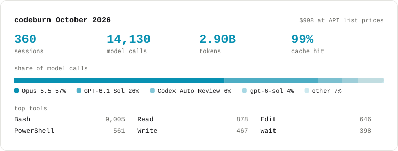

## Kim Julongbayan\n\nFull-stack developer in Quezon City, Philippines. TypeScript, Postgres and LLMs, in production systems that people use every workday.\n\n[kimlj.dev](https://kimlj.dev) · [Hub](https://kimlj.dev/hub)\n\n### What I'm building\n\n**MDS Pro Solutions platform** · private, client work\nTimekeeping and billing for a US nursing company, used every workday by 15 people. Clock-ins are stamped by Postgres and records are append-only, and every change goes through an approved, attributed correction, so payroll and invoices are built from records nobody edits by hand. TypeScript, Fastify, Supabase, and a Chrome extension side panel the nurses clock in from. Its Ask AI agent answers admin questions through a SELECT-only Postgres role.\n\n**[WordWarz.io](https://wordwarz.io)** · live, web, App Store and Google Play\nReal-time multiplayer word game. React and Capacitor over Node.js and Socket.IO, with ELO-matched AI bots. 40 to 70 people play on a given day; 570 players and 1,045 multiplayer matches since launch, grown by word of mouth with no ads (Sep 2026).\n\n**Cockpit** · not public yet, [93-second film](https://kimlj.dev/cockpit) (made with Claude Code)\nA local control plane for coding agents, built on DeepSeek Harness. One agent builds, deterministic tests check the work with no AI involved, a second read-only agent reviews it in a fixed format and sends problems back, and nothing is checkpointed until I approve it.\n\n**[Jobsift](https://github.com/kimlj/jobsift)** · runs 24/7 on a VPS\nJob pipeline that reads boards' own APIs and alert emails instead of scraping, filters before any model call, and drafts applications with a separate verifier that checks every claim against the evidence.\n\n**[Shift Ops Console](https://github.com/kimlj/shift-ops-console)** · simulated data\nShift-attendance exception engine across n8n, Apps Script, Make, Power Automate and Zapier. Scored against planted ground truth: 359 of 370 anomalies caught (97.0%), and the scorer itself rebuilt when it turned out to be wrong.\n\n### Merged upstream\n\n| Project | Stars | Pull request |\n|---|---|---|\n| [mastra-ai/mastra](https://github.com/mastra-ai/mastra) | 29,000+ | [#19906](https://github.com/mastra-ai/mastra/pull/19906) Honor `Retry-After` on agent model-call retries |\n| [recharts/recharts](https://github.com/recharts/recharts) | 27,000+ | [#7570](https://github.com/recharts/recharts/pull/7570) `XAxis height="auto"`, sized to its tick labels [#7565](https://github.com/recharts/recharts/pull/7565) Fix "Maximum update depth exceeded" when scrubbing fast [#7566](https://github.com/recharts/recharts/pull/7566) `connectNulls` across stacked points where every series is null [#7798](https://github.com/recharts/recharts/pull/7798) Website example for `height="auto"` |\n| [getagentseal/codeburn](https://github.com/getagentseal/codeburn) | 11,000+ | [#1791](https://github.com/getagentseal/codeburn/pull/1791) Keep every parallel tool call of a streamed Claude message |\n\nAlso traced the root cause of focus-stealing terminal windows in [openai/codex](https://github.com/openai/codex/issues/48074) (127,000+ stars) on Windows to two process-launch lines in its sandbox. Codex takes no outside code; OpenAI wrote and shipped the fix.\n\n### This month, measured by codeburn\n\n<picture>\n  <source media="(prefers-color-scheme: dark)" srcset="assets/usage-dark.svg">\n  \n</picture>\n\nMy own Claude Code and Codex usage, read from local session files by [codeburn](https://github.com/getagentseal/codeburn).\n